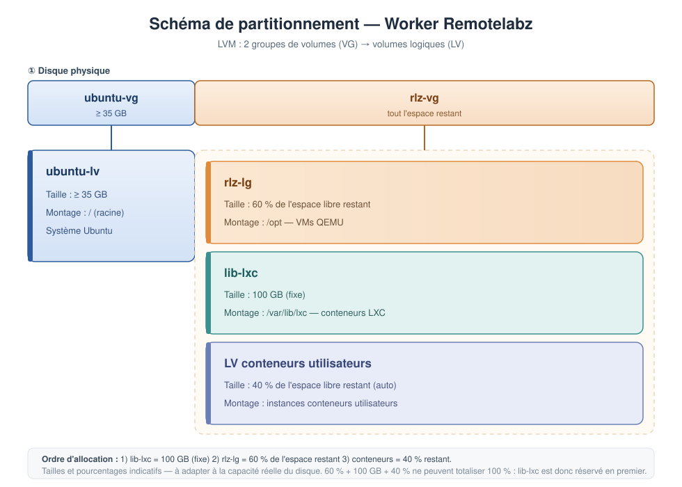

# Guide de partitionnement disque — Worker Remotelabz

> Document côté **worker**. Décrit la disposition LVM attendue : un VG pour le
> système Ubuntu, un second VG pour les charges Remotelabz (VMs QEMU, conteneurs LXC,
> instances utilisateurs) avec un **pool thin** dédié aux instances LXC.

## 1. Vue d'ensemble



Deux **groupes de volumes** (VG) sont créés sur le disque :

| VG | Rôle | Contenu |
|---|---|---|
| `ubuntu-vg` | Système (défaut Ubuntu) | LV `ubuntu-lv` ≥ 35 GB → `/` |
| `rlz-vg` | Charges Remotelabz | `rlz-lv`, `lib-lxc`, pool thin `rlz-lxc-pool` |

Le pool thin `rlz-lxc-pool` regroupe l'espace destiné aux **instances LXC
utilisateurs**. Les volumes logiques de ces instances (`lxc_<uuid>`) y sont créés
**à la volée**, au démarrage de chaque instance et à la taille demandée, sans
pré-allocation physique : seul l'espace réellement écrit consomme du disque.

## 2. Détail des volumes logiques

| LV | VG | Type | Taille | Point de montage | Usage |
|---|---|---|---|---|---|
| `ubuntu-lv` | `ubuntu-vg` | linéaire | ≥ 35 GB | `/` | Système Ubuntu |
| `rlz-lv` | `rlz-vg` | linéaire | 60 % de l'espace libre restant | `/opt` | VMs QEMU |
| `lib-lxc` | `rlz-vg` | linéaire | 100 GB (fixe) | `/var/lib/lxc` | Modèles / conteneurs LXC de référence |
| `rlz-lxc-pool` | `rlz-vg` | **thin pool** | tout l'espace libre restant | — | Réserve des volumes *thin* des instances LXC |
| `lxc_<uuid>` | `rlz-vg` | thin (dans `rlz-lxc-pool`) | taille du flavor, sinon `DEFAULT_MIN_DISKSPACE_LXC` | `/var/lib/lxc/<uuid>/rootfs` | Rootfs d'une instance LXC utilisateur |

> Les LV d'instances (`lxc_<uuid>`) ne figurent pas dans l'installation : le worker
> les crée et les supprime dynamiquement (`lxc_setup_disk()` / `lxc_remove_disk()`
> dans `InstanceManager`).

## 3. Schéma ASCII

```
┌───────────────────────────────────────────────────────────────────────────────────┐
│                                  DISQUE PHYSIQUE                                  │
├───────────────────────┬───────────────────────────────────────────────────────────┤
│       ubuntu-vg       │                          rlz-vg                           │
│       (≥ 35 GB)       │                  (tout l'espace restant)                  │
│   ┌───────────────┐   │   ┌───────────────────────────────────────────────────┐   │
│   │   ubuntu-lv   │   │   │  rlz-lv    60 % libre restant   →  /opt   (QEMU)  │   │
│   │    ≥ 35 GB    │   │   ├───────────────────────────────────────────────────┤   │
│   │     →  /      │   │   │  lib-lxc   100 GB (fixe)        →  /var/lib/lxc   │   │
│   │  (OS Ubuntu)  │   │   ├───────────────────────────────────────────────────┤   │
│   │               │   │   │  rlz-lxc-pool  (thin pool → espace restant)       │   │
│   │               │   │   │    ├─ lxc_<uuid1>  (créé à la volée) → rootfs     │   │
│   │               │   │   │    ├─ lxc_<uuid2>  (créé à la volée) → rootfs     │   │
│   │               │   │   │    └─ …                                           │   │
│   └───────────────┘   │   └───────────────────────────────────────────────────┘   │
└───────────────────────┴───────────────────────────────────────────────────────────┘
```

Ordre d'allocation dans `rlz-vg` :

```
        espace libre F  =  taille(rlz-vg)
                │
                ├─ 1) lib-lxc .................... 100 GB  (fixe)  →  /var/lib/lxc
                │
                ├─ 2) rlz-lv ............. 60 % de (F - 100 GB)  →  /opt
                │
                └─ 3) rlz-lxc-pool ....... 100 % de l'espace restant  (thin pool)
                          ├─ lxc_<uuid1>  créé à la volée  →  /var/lib/lxc/<uuid1>/rootfs
                          └─ lxc_<uuid2>  créé à la volée  →  /var/lib/lxc/<uuid2>/rootfs
```

## 4. Mise en œuvre

### 4.1 `ubuntu-vg` / `ubuntu-lv` (≥ 35 GB)

Ces noms sont ceux produits **par défaut par l'installateur Ubuntu** en mode LVM guidé.
Pour garantir au moins 35 GB au système, sélectionner l'option LVM au partitionnement puis
ajuster la taille du volume `ubuntu-lv` dans l'assistant (`/` ≥ 35 GB).

### 4.2 Création de `rlz-vg`, de ses LV et du pool thin

```bash
# Créer le VG avec tout l'espace disque restant
vgcreate rlz-vg /dev/<partition_ou_disque>

# 1) lib-lxc : 100 GB fixes pour les conteneurs LXC (modèles / références)
lvcreate -L 100G -n lib-lxc rlz-vg

# 2) rlz-lv : 60 % de l'espace ENCORE libre (calculé après lib-lxc)
lvcreate -l 60%FREE -n rlz-lv rlz-vg

# 3) rlz-lxc-pool : pool thin pour les instances LXC, sur l'espace restant.
#    On garde ~5 % libre au VG pour les métadonnées du pool et les extensions.
lvcreate -l 95%FREE --thinpool rlz-lxc-pool rlz-vg
```

> `-l 60%FREE` et `-l 95%FREE` se réfèrent à l'espace libre **au moment de la commande** :
> l'ordre ci-dessus implémente donc directement l'interprétation du §3.

### 4.3 Formater et monter

Seuls les LV « classiques » sont formatés et montés à l'installation. Les LV
d'instances sont formatés (`mkfs.ext4`) et montés par le worker au démarrage de
chaque instance.

```bash
mkfs.ext4 /dev/rlz-vg/rlz-lv
mkfs.ext4 /dev/rlz-vg/lib-lxc

mkdir -p /opt /var/lib/lxc
mount /dev/rlz-vg/rlz-lv /opt
mount /dev/rlz-vg/lib-lxc /var/lib/lxc
```

Persistance dans `/etc/fstab` (identifiants stables, pas le nom du VG) :

```
/dev/mapper/rlz--vg-rlz--lv         /opt            ext4  defaults  0 2
/dev/mapper/rlz--vg-lib--lxc        /var/lib/lxc    ext4  defaults  0 2
```

### 4.4 Vérification

```bash
vgs                                                    # espace libre/utilisé par VG
lvs -a -o +lv_size,data_percent,metadata_percent       # détail des LV et remplissage du pool
df -h /opt /var/lib/lxc                                # montages effectifs
```

## 5. Provisionnement thin et création à la volée

Pour chaque instance LXC utilisateur, le worker crée dynamiquement un volume
*thin* dans le pool `rlz-vg/rlz-lxc-pool`, puis le formate et le monte :

```bash
# Taille = flavorDisk.disk si défini, sinon DEFAULT_MIN_DISKSPACE_LXC
lvcreate -y -Wy --type thin -V <taille>M --thinpool rlz-vg/rlz-lxc-pool -n lxc_<uuid>
mkfs.ext4 /dev/rlz-vg/lxc_<uuid>
mount /dev/rlz-vg/lxc_<uuid> /var/lib/lxc/<uuid>/rootfs
```

À la suppression de l'instance, le worker démonte puis détruit le volume
(`umount` + `lvremove -f rlz-vg/lxc_<uuid>`).

Conséquences du thin provisioning :

- La **taille virtuelle** des LV peut largement dépasser la capacité physique du
  pool : c'est la sur-allocation. Seuls les blocs réellement écrits consomment
  de l'espace.
- Un VG peut avoir **0 PE libre** tout en pouvant encore accueillir de nouveaux
  volumes *thin* (dans la limite de la capacité virtuelle du pool). Le contrôle
  d'espace libre du VG (`vgs -o vg_free_count`) n'est donc **pas un indicateur
  pertinent** pour autoriser la création d'une instance : c'est le remplissage du
  **pool** qui compte.
- Surveiller le remplissage réel du pool :

  ```bash
  lvs -o +data_percent,metadata_percent,pool_lv rlz-vg/rlz-lxc-pool
  ```

  Si le taux `data_percent` approche 100 %, étendre le pool (`lvextend`) ou
  ajouter un PV au VG. Un pool plein fait échouer les écritures des instances.

## 6. Points d'attention

| Sujet | Recommandation |
|---|---|
| Taille du VG système | Ne pas descendre sous 35 GB pour `/` (mises à jour, logs, paquets). |
| `lib-lxc` fixe | Prévoir de la marge : les conteneurs de référence grossissent vite (`lvextend` à chaud possible). |
| Remplissage du pool thin | Surveiller `data_percent` / `metadata_percent` de `rlz-lxc-pool` : la sur-allocation peut épuiser le disque physique. |
| Espace libre du VG | Ne pas allouer 100 % de `rlz-vg` : laisser ~5 % libre pour les métadonnées du pool et les extensions. |
| Migration | Utiliser les chemins `/dev/mapper/...` dans `fstab` plutôt que `/dev/rlz-vg/...`. |
